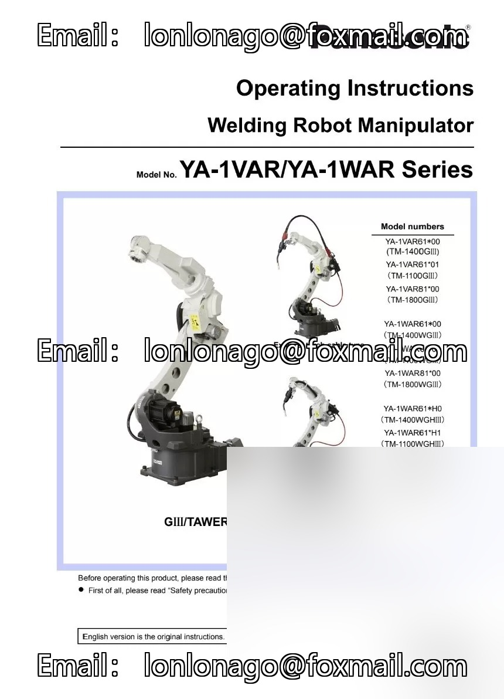
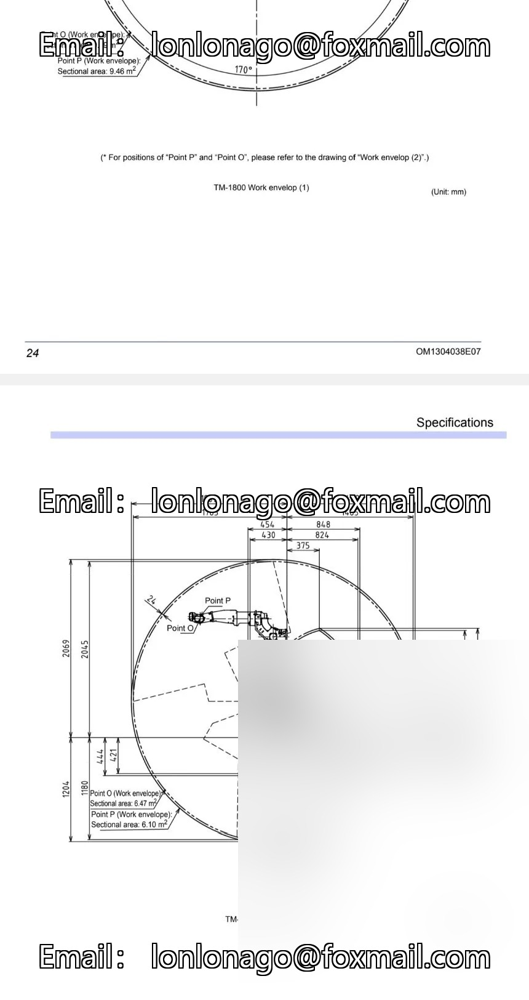
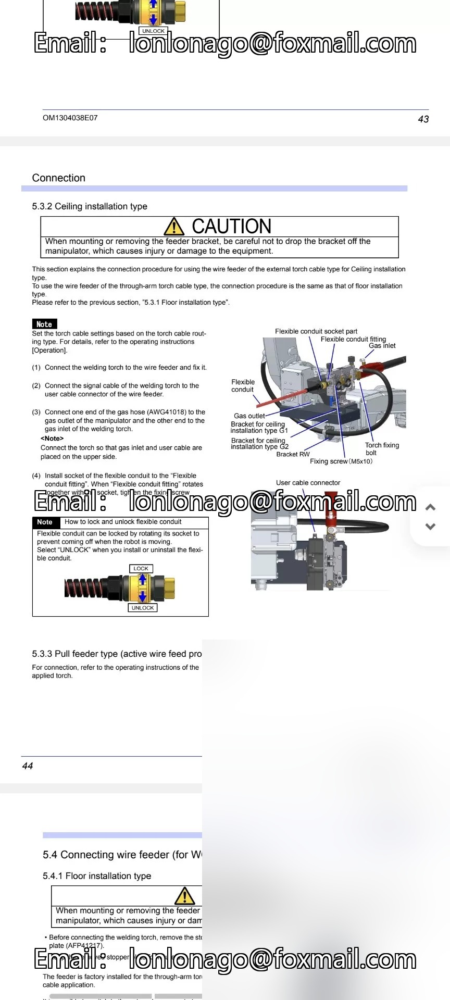
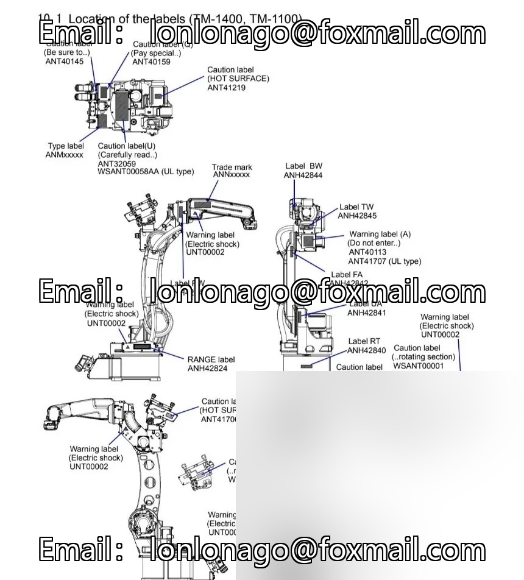

# Panasonic / Panasonic Welding Robot YA-1VAR / YA-1WA

## Body

Panasonic Lowercase Scissor Robotics YA-1VAR/YA-1WAR series operation manual 80 pages. , complete content, including model, specifications, connection methods, safety instructions, label locations, etc., suitable for professional uses such as equipment maintenance, spare parts procurement, and system maintenance.
The materials are in PDF format, directly sent with the network drive link.
Not refundable.
169578

The documentation covers Panasonic welding robot YA-1VAR/YA-1WA series operation instructions, including model, specifications, connection methods, safety notes and label locations, suitable for professional maintenance, spare parts procurement and system maintenance.

<!-- AI_ENRICHED -->

## Images

## Payment

Here is a pay link on Stripe ( https://buy.stripe.com/3cs8yP7sY87d0vu9AB ). Please contact me lonlonago@foxmail.com after funding $89, and I will send you a complete data files , thank you!

